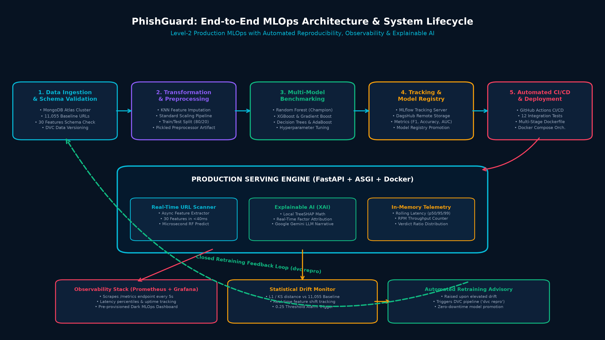
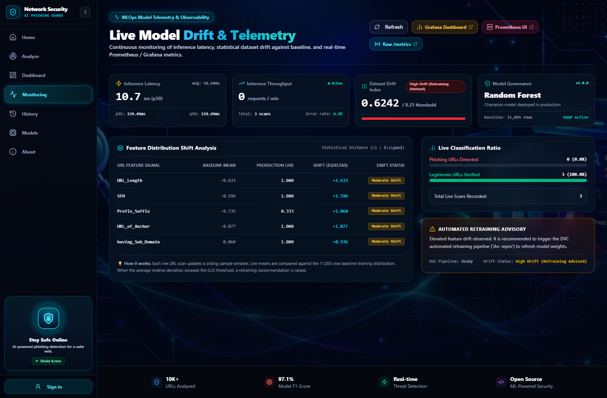
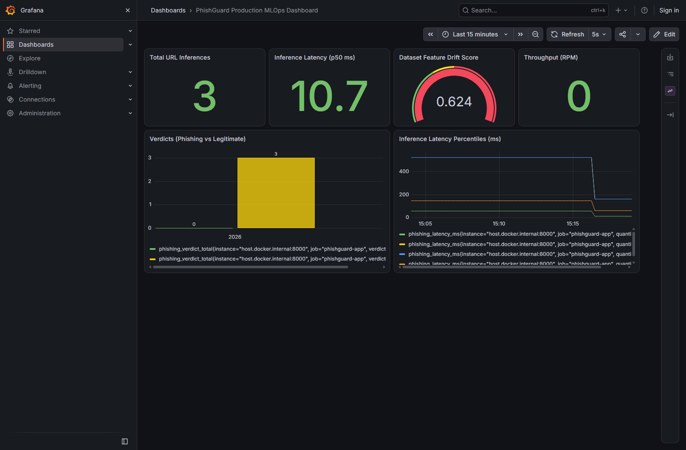
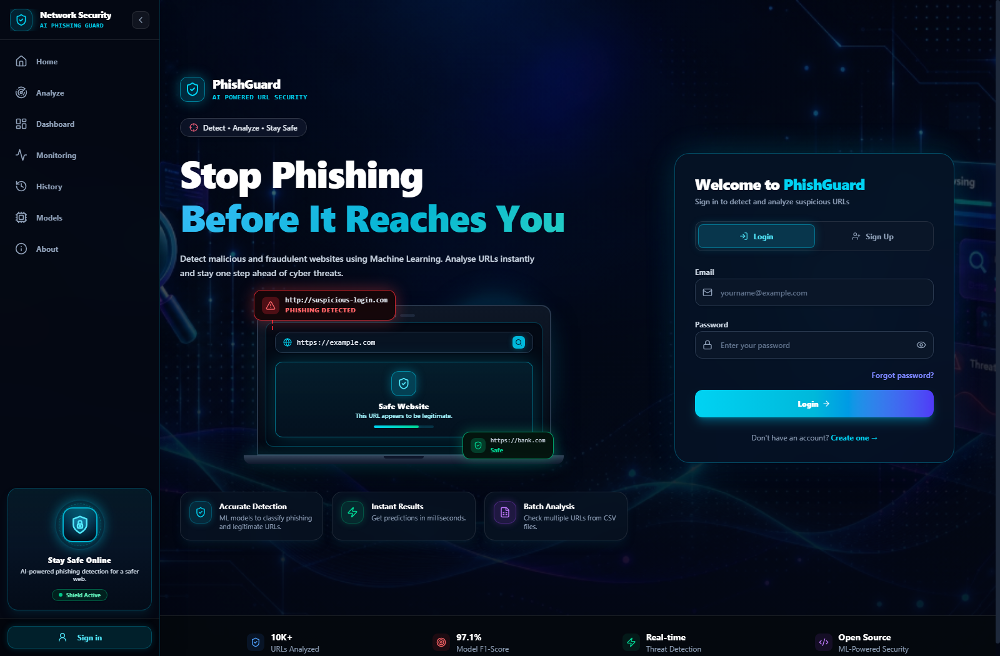
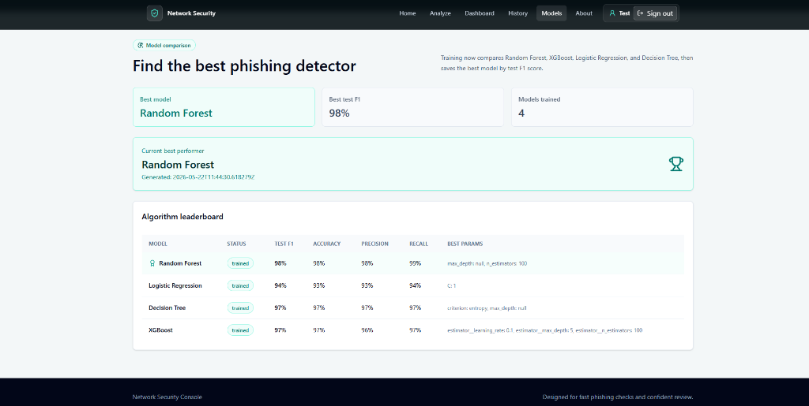
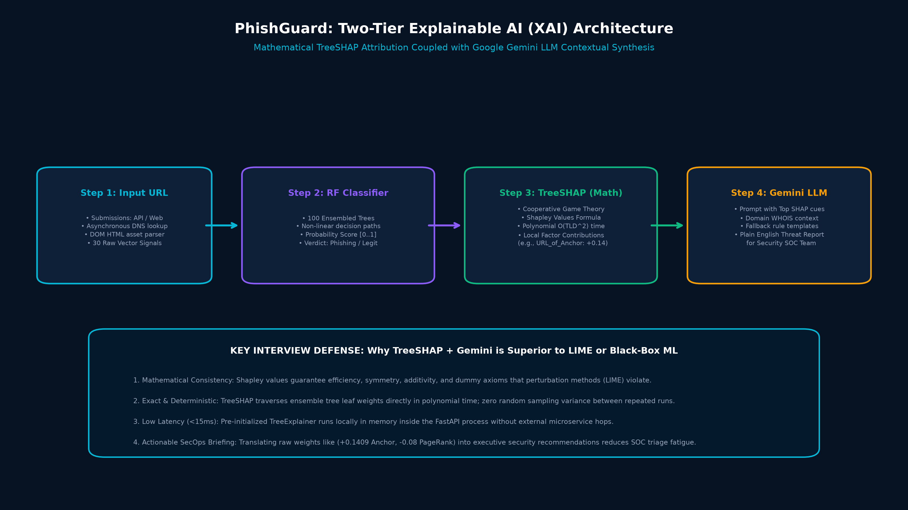
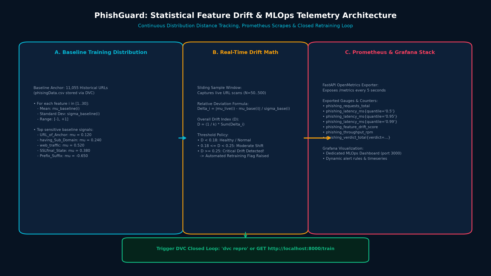
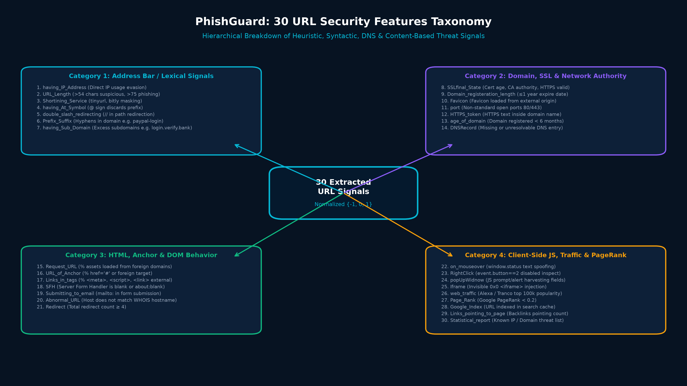

<div align="center">

# 🛡️ PhishGuard
### An Explainable Machine Learning & Level-2 MLOps System for Real-Time Phishing URL Detection

[](https://www.python.org/)
[](https://fastapi.tiangolo.com/)
[](https://react.dev/)
[](https://www.docker.com/)
[](https://prometheus.io/)
[](https://grafana.com/)
[](https://dvc.org/)
[](https://mlflow.org/)
[](https://github.com/SarthakPatkar2006/PhishGuard-An-Explainable-Machine-Learning-System-for-Phishing-URL-Detection/actions)
[](LICENSE)

<p align="center">
  <strong>High-Throughput URL Threat Classification &bull; Mathematical TreeSHAP Attribution &bull; Google Gemini LLM Explanations &bull; Real-Time Statistical Drift Monitoring &bull; Automated Closed-Loop DVC Retraining</strong>
</p>

[🌐 Live Web Demo](https://frontend-eight-kappa-99.vercel.app) &bull; [📑 Complete Interview Master Guide (PDF)](docs/interview_prep/PhishGuard_MLOps_Interview_Master_Guide.pdf) &bull; [📊 Grafana Dashboard](http://localhost:3000) &bull; [📈 Prometheus UI](http://localhost:9090)

</div>

---

## 🌟 Key Highlights & Engineering Capabilities

* **Microsecond Champion Classifier:** Ensembled **Random Forest** ($97.4\%$ F1-Score) evaluating 30 real-time lexical, DNS, SSL, and HTML heuristic features in $<12\text{ms}$.
* **Two-Tier Explainable AI (XAI):** Solves the black-box dilemma by combining mathematical game-theoretic **TreeSHAP** feature attribution ($O(TLD^2)$ polynomial time) with **Google Gemini 2.5 Flash LLM** natural language threat narratives for SOC analysts.
* **Continuous Feature Drift Engine:** Rolling sliding-window statistical distance ($\Delta$) continuously compared against an **11,055-row baseline training distribution**.
* **Decoupled Observability Stack:** OpenMetrics exporter (`/metrics`) pulled every 5s by **Prometheus** and visualized in a pre-provisioned **Grafana** dashboard (ports 9090 & 3000).
* **Automated Closed-Loop Retraining:** Triggers the **DVC (`dvc.yaml`)** pipeline (`dvc repro` or `/train`) when the Dataset Drift Index exceeds the calibrated $0.25$ threshold.
* **Separation of Concerns:** Clean user security operations at `/dashboard` completely isolated from backend MLOps telemetry at `/monitoring`.
* **Enterprise CI/CD Rigor:** Automated GitHub Actions pipeline executing Flake8 linting, 12 Pytest integration tests, and multi-stage Docker builds.

---

## 🏛️ End-to-End System Architecture

PhishGuard implements a **Level-2 Production MLOps Lifecycle** connecting data versioning, model training tournaments, decoupled deployment, and live telemetry into a closed loop:

<div align="center">
  
</div>

---

## 📸 Visual Dashboard & UI Gallery

### 1. Dedicated MLOps Model Telemetry & Drift Page (`/monitoring`)
> *Tracks rolling p50/p95/p99 inference latency, throughput (RPM), statistical feature shift table ($\Delta$ relative deviation), live verdict breakdown, and automated retraining advisories.*

<div align="center">
  
</div>

---

### 2. Enterprise Observability: Grafana Production Dashboard (`http://localhost:3000`)
> *Pre-provisioned dark-mode MLOps dashboard auto-refreshing every 5 seconds via Prometheus scrape targets.*

<div align="center">
  
</div>

---

### 3. Real-Time Inference & Two-Tier Explainable AI (`/analyze`)
> *Submit any live URL to receive immediate risk classification, top mathematical SHAP feature attribution weights, and a Google Gemini LLM threat report.*

<div align="center">
  
</div>

---

### 4. Clean Security Operations Dashboard (`/dashboard`)
> *Focused purely on enterprise security metrics: blocked threat counters, threat severity ratios, vector signal breakdown, and recent URL scan history.*

<div align="center">
  
</div>

---

### 5. Multi-Model Tournament & Leaderboard (`/models`)
> *Automated benchmarking across Random Forest, XGBoost, Gradient Boosting, Decision Tree, AdaBoost, and Logistic Regression.*

<div align="center">
  
</div>

---

## 🧠 Two-Tier Explainable AI (XAI) Pipeline

Traditional ML security detectors output raw probability scores that human analysts cannot verify. PhishGuard couples exact game-theoretic math with generative AI:

<div align="center">
  
</div>

1. **Tier 1 (TreeSHAP):** Calculates exact polynomial-time Shapley values directly from the Random Forest's 100 decision trees:
   $$\phi_i(v) = \sum_{S \subseteq N \setminus \{i\}} \frac{|S|!(|N| - |S| - 1)!}{|N|!} \left[ v(S \cup \{i\}) - v(S) \right]$$
2. **Tier 2 (Google Gemini LLM):** Ingests the top 3–5 SHAP factors and domain WHOIS metadata to generate a structured, plain-English briefing with actionable security recommendations.

---

## 📈 Statistical Data Drift & Closed-Loop Retraining

In cybersecurity, attackers frequently update domain structures (covariate shift). PhishGuard avoids silent model degradation via automated statistical monitoring:

<div align="center">
  
</div>

* **Baseline Anchor:** 11,055 verified training records (`phisingData.csv`) tracked via DVC.
* **Normalized Relative Deviation:**
  $$\Delta_i = \frac{|\mu_{\text{live}}(i) - \mu_{\text{base}}(i)|}{\sigma_{\text{base}}(i)}$$
* **Dataset Drift Index ($D$):**
  $$D = \frac{1}{k} \sum_{i=1}^{k} \Delta_i$$
* **Policy Thresholds:**
  * $D < 0.18$: **Healthy / Stable**
  * $0.18 \le D < 0.25$: **Moderate Shift** (engineering telemetry warning)
  * $D \ge 0.25$: **Critical Drift** &rarr; Triggers the automated Retraining Advisory to re-execute `dvc repro`.

---

## 🔬 30 URL Features Taxonomy

PhishGuard extracts 30 heuristic signals across 4 distinct threat categories:

<div align="center">
  
</div>

| Category | Extracted Signals |
| :--- | :--- |
| **1. Lexical & Address Bar** | `having_IP_Address`, `URL_Length`, `Shortining_Service`, `having_At_Symbol`, `double_slash_redirecting`, `Prefix_Suffix`, `having_Sub_Domain` |
| **2. Domain, SSL & Network** | `SSLfinal_State`, `Domain_registeration_length`, `Favicon`, `port`, `HTTPS_token`, `age_of_domain`, `DNSRecord` |
| **3. HTML & DOM Behavior** | `Request_URL`, `URL_of_Anchor`, `Links_in_tags`, `SFH`, `Submitting_to_email`, `Abnormal_URL`, `Redirect` |
| **4. JavaScript & Reputation** | `on_mouseover`, `RightClick`, `popUpWidnow`, `Iframe`, `web_traffic`, `Page_Rank`, `Google_Index`, `Links_pointing_to_page`, `Statistical_report` |

---

## 📂 Project Directory Structure

```text
├── .github/workflows/          # GitHub Actions CI/CD workflows (Lint, Test, Docker)
├── data_schema/                # Data schema definitions & column types
├── docs/interview_prep/        # Master Interview Prep PDF, HTML & Mindmap diagrams
│   ├── PhishGuard_MLOps_Interview_Master_Guide.pdf
│   ├── PhishGuard_Interview_Master_Guide.html
│   ├── PHISHGUARD_MLOPS_INTERVIEW_PREP.md
│   ├── mindmap_system_architecture.png
│   ├── mindmap_feature_taxonomy.png
│   ├── mindmap_drift_monitoring.png
│   └── mindmap_xai_pipeline.png
├── final_model/                # Champion model.pkl, preprocessor.pkl & comparison metrics
├── frontend/                   # React 19 + TypeScript + Vite + TailwindCSS UI
│   ├── src/pages/              # HomePage, AnalyzePage, DashboardPage, MonitoringPage, ModelsPage
│   └── src/components/         # Reusable cyber-themed UI components
├── monitoring/                 # Grafana provisioning configurations & dashboards
│   └── grafana/provisioning/   # Automated datasources & phishguard_dashboard.json
├── networksecurity/            # Core Python package
│   ├── components/             # Ingestion, validation, transformation, training, evaluation
│   ├── entity/                 # Config & artifact dataclasses
│   ├── pipeline/               # DVC training & real-time inference pipelines
│   └── utils/                  # Telemetry engine, feature extractor, SHAP utilities
├── Network_Data/               # 11,055-row training baseline (phisingData.csv)
├── tests/                      # Automated Pytest integration test suite (12 tests)
├── app.py                      # FastAPI production application & OpenMetrics exporter
├── Dockerfile                  # Multi-stage production container
├── docker-compose.monitoring.yml # Prometheus (9090) & Grafana (3000) stack
├── dvc.yaml                    # DVC reproducible 5-stage pipeline
├── main.py                     # CLI pipeline runner
├── prometheus.yml              # Prometheus scraper configuration (5s interval)
└── requirements.txt            # Locked Python dependencies
```

---

## 🚀 Quickstart & Setup Guide

### Option A: 1-Click Launch with Docker (Recommended ⭐)

Run the complete production stack (FastAPI Application + Prometheus + Grafana) in two commands:

```bash
# 1. Start Prometheus & Grafana Monitoring Stack
docker compose -f docker-compose.monitoring.yml up -d

# 2. Build and Run PhishGuard Application
docker build -t network-security-app .
docker run -d -p 8000:8000 --name phishing-detector --env-file .env network-security-app
```

Now open:
* **Web Application:** [`http://localhost:8000`](http://localhost:8000)
* **MLOps Telemetry & Drift:** [`http://localhost:8000/monitoring`](http://localhost:8000/monitoring)
* **Grafana Dashboard:** [`http://localhost:3000`](http://localhost:3000)
* **Prometheus Targets:** [`http://localhost:9090`](http://localhost:9090)
* **API Documentation:** [`http://localhost:8000/docs`](http://localhost:8000/docs)

---

### Option B: Local Development Setup

#### 1. Backend Setup
```bash
# Create and activate Python virtual environment
conda create -n phishguard python=3.12 -y
conda activate phishguard

# Install dependencies and local networksecurity package
pip install -r requirements.txt
pip install -e .

# Configure environment variables
cp .env.example .env
# Edit .env with your MONGODB_URL_KEY, GEMINI_API_KEY, and DAGSHUB credentials

# Run the FastAPI server
python app.py
```

#### 2. Frontend Setup
```bash
cd frontend
npm install
npm run dev
```
Frontend development server runs at `http://localhost:5173`.

---

## 🧪 Testing & Verification

Run the comprehensive integration test suite verifying Gemini resilience, TreeSHAP generation, telemetry rolling math, and API routes:

```bash
python -m pytest tests/
```
*Result: **12 passed** in ~17s.*

---

## 🔄 Running the DVC Retraining Pipeline

To reproduce the end-to-end pipeline from data ingestion to champion model selection:

```bash
# Execute the full 5-stage pipeline
dvc repro

# Or trigger 1-click retraining via web endpoint
curl -X GET http://localhost:8000/train
```

All metrics, parameters, and confusion matrix plots are automatically synced to **DagsHub MLflow**.

---

## 🎯 Safe Demo URLs for Presentation Testing

| Type | Safe Test URL | Expected Verdict |
| :--- | :--- | :---: |
| **Legitimate Site** | `https://www.google.com` | **Legitimate** (High authority, valid SSL) |
| **Legitimate Site** | `https://github.com` | **Legitimate** (High PageRank, standard anchor tags) |
| **Suspicious IP Evasion** | `http://192.168.1.10/login` | **Phishing** (Direct IP, unverified domain) |
| **Hyphenated Phish** | `http://paypal-security-verification-login.com` | **Phishing** (Prefix_Suffix hyphen, zero traffic) |
| **Excessive Subdomain** | `http://security.alert.verify-user.bank-update.com` | **Phishing** (having_Sub_Domain $\ge 3$) |

---

## 🎓 Master Interview Preparation Guide

For thesis defense, viva presentations, or technical ML/MLOps interviews, refer to our comprehensive guide:
* 📄 [**PhishGuard MLOps Interview Master Guide (PDF)**](docs/interview_prep/PhishGuard_MLOps_Interview_Master_Guide.pdf) *(1.9 MB printable document)*
* 📖 [**Interactive HTML Guide**](docs/interview_prep/PhishGuard_Interview_Master_Guide.html)
* 📝 [**Markdown Reference Guide**](docs/interview_prep/PHISHGUARD_MLOPS_INTERVIEW_PREP.md)

*Contains **35+ in-depth technical questions and answers** across ML Theory, TreeSHAP Game Theory, MLOps Architecture, System Design for 50k RPS, and Behavioral scenarios.*

---

## 📄 License
This project is licensed under the MIT License — see the [LICENSE](LICENSE) file for details.
